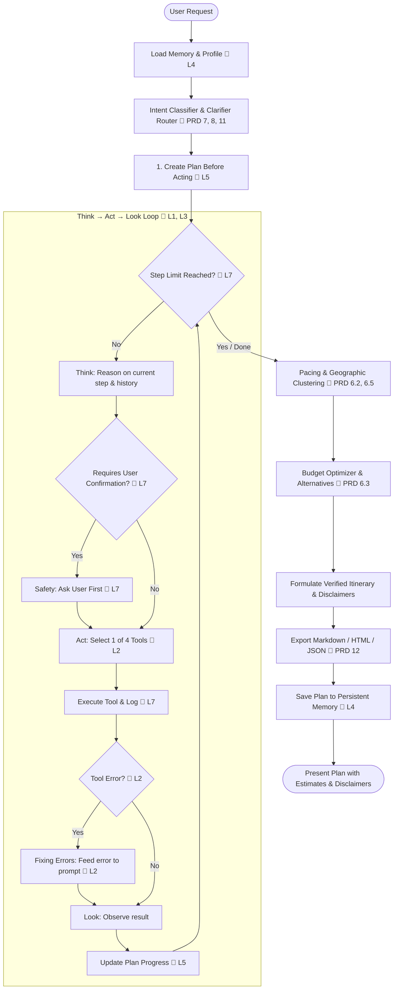

# Task Execution Plan: Smart Travel Planner AI Agent

**Document:** Agent Implementation & Execution Roadmap  
**Reference PRD:** [`smart_travel_planner_ai_agent_prd.md`](smart_travel_planner_ai_agent_prd.md)  
**Curriculum Alignment:** Lessons L1 – L8 (ReAct Loop, Tools, Self-Correction, Memory, Planning, Safety, Two-Tier Testing)  
**Status:** ✅ ALL PHASES COMPLETE — Verified (Phases 1–5)  

---

## 1. Architectural Blueprint (L1 – L8 Mapping)

### Core Architecture Pillars

| Requirement | Module / Component | Implementation in Smart Travel Planner |
| :--- | :--- | :--- |
| **A loop: think → act → look** 📘 L1, L3 | [`agent/core_loop.py`](agent/core_loop.py) | ReAct cycle executing `Think` (reasoning), `Act` (tool invocation), and `Look` (observation of tool result) with [`agent/react_parser.py`](agent/react_parser.py). |
| **2–4 tools, clearly described** 📘 L2 | [`agent/tools/`](agent/tools/) | Exactly 4 focused tools with strict schemas: `search_destination_and_attractions`, `calculate_budget_breakdown`, `find_transport_options`, `get_travel_advisory_and_weather`. |
| **Fixing errors when a tool fails** 📘 L2 | [`agent/tools/base.py`](agent/tools/base.py) | Try-catch wrapping in `safe_execute()` feeding diagnostic error details back to agent for automatic self-correction. |
| **Memory between tasks** 📘 L4 | [`agent/memory.py`](agent/memory.py) | `TripMemoryStore` persisting user preferences, past travel destinations, and trip history across tasks in [`data/memory.json`](data/memory.json). |
| **A plan before it acts** 📘 L5 | [`agent/planner.py`](agent/planner.py) | `PlannerEngine` formulating an execution plan checklist before executing tools, tracking step status (`PENDING` $\to$ `IN_PROGRESS` $\to$ `COMPLETED`). |
| **Safety: asks you first, step limit, log** 📘 L7 | [`agent/safety.py`](agent/safety.py) | **1. Asks first:** Human-in-the-loop approval on budget overrun or overwrite. **2. Step limit:** Hard ceiling (`max_steps = 10`) preventing infinite loops. **3. Logger:** Audit logger tracking `[THOUGHT]`, `[ACTION]`, and `[LOOK]`. |
| **Tests: fake LLM first, then a real one** 📘 L8 | [`tests/`](tests/) | **Tier 1:** 34 passing unit tests across 5 test modules. **Tier 2:** Integration test in [`tests/test_real_llm.py`](tests/test_real_llm.py) with real LLM fallback. |

---

## 2. Step-by-Step Execution Plan

### Phase 1: Foundations, Schemas & Memory (L4)
- [x] **Task 1.1: Project Structure & Environment Setup**
  - Scaffolding complete: `agent/`, `agent/tools/`, `tests/`, `data/`, `config.py`.
  - Python 3.12 runtime configured.
- [x] **Task 1.2: Persistent Memory Engine (L4)**
  - Implemented `TripMemoryStore` in [`agent/memory.py`](agent/memory.py).
  - Handles `UserPreferences`, past visited destinations, active trip drafts, and persistence in `data/memory.json`.

---

### Phase 2: Intent Routing, Clarifications & Delta Plan Refinement (PRD 6.8, 7, 11)
- [x] **Task 2.1: Intent Classifier & Single-Question Clarifier**
  - Implemented `IntentRouter` in [`agent/router.py`](agent/router.py) handling `NEW_TRIP`, `CLARIFY_INFO`, `EXPLORE_DESTINATIONS`, `REFINE_PLAN`.
  - Enforces "one clear question at a time" rule when essential details (destination or duration) are missing.
- [x] **Task 2.2: Conversational Session Orchestration**
  - Implemented `ConversationalAgent` in [`agent/conversation.py`](agent/conversation.py).
- [x] **Task 2.3: Delta Itinerary Refinement Engine (PRD Section 6.8)**
  - Implemented `DeltaPlanRefiner` in [`agent/refiner.py`](agent/refiner.py) to modify active trips (e.g. "make Day 1 relaxing", "change budget to luxury") while preserving unchanged days.
- [x] **Task 2.4: Destination Discovery & Recommendations (PRD Section 6.1)**
  - Implemented `DestinationSearchTool.recommend_destinations()` filtering destinations by starting location and budget.

---

### Phase 3: Live Information Retrieval, Weather & Operating Constraints (PRD 6.2, 6.7)
- [x] **Task 3.1: Live Real-Time Weather Integration (Open-Meteo)**
  - Implemented `WeatherService` in [`agent/tools/weather_service.py`](agent/tools/weather_service.py) fetching live temperature, weather conditions, and dynamic safety advisories.
  - Merged into `TravelAdvisoryTool` in [`agent/tools/advisory_tool.py`](agent/tools/advisory_tool.py).
- [x] **Task 3.2: Operational Hours & Closed-Day Constraint Engine (PRD Section 6.2 & 10)**
  - Implemented `ConstraintEngine` in [`agent/constraints.py`](agent/constraints.py).
  - Detects closed days (e.g., Edakkal Caves closed on Mondays) and seasonal restrictions. Automatically re-sequences activities.
- [x] **Task 3.3: Dynamic ReAct Parser & Formatter (📘 L1, L3)**
  - Implemented `ReActParser` in [`agent/react_parser.py`](agent/react_parser.py) for structured ReAct prompt parsing.

---

### Phase 4: Geographic Pacing, Budget Optimizer & Multi-Format Exporters (PRD 6.2, 6.3, 12)
- [x] **Task 4.1: Geographic Clustering & Pacing Engine (PRD Section 6.2 & 6.5)**
  - Implemented `PacingEngine` in [`agent/pacing.py`](agent/pacing.py) mapping sights to regional zones (e.g. West Vythiri, South Meppadi, East Sulthan Bathery).
  - Eliminates criss-cross transit fatigue and embeds authentic dining/lunch stops with dietary filtering (e.g. pure vegetarian messes).
- [x] **Task 4.2: Budget Optimization & Multi-Tier Package Generator (PRD Section 6.3)**
  - Implemented `BudgetOptimizer` in [`agent/budget_optimizer.py`](agent/budget_optimizer.py).
  - Generates 3 comparative packages (Eco-Saver, Comfort, Deluxe), computes exact overrun deltas, and provides actionable cost-saving trade-offs.
- [x] **Task 4.3: Multi-Format Itinerary Exporter (PRD Section 12)**
  - Implemented `ItineraryExporter` in [`agent/exporter.py`](agent/exporter.py) generating clean Markdown (`.md`), shareable JSON (`.json`), and print-ready HTML (`.html`).
- [x] **Task 4.4: Conversational Export & Budget Commands**
  - Integrated `export` and `compare budget` commands directly into `ConversationalAgent` and `main.py`.
- [x] **Task 4.5: Phase 4 Automated Test Suite**
  - Implemented [`tests/test_phase4.py`](tests/test_phase4.py) with 6 comprehensive test cases. All 34 tests passing cleanly.

---

## 3. Progress Tracking Checklist

| Component | Lesson / PRD | Status | Notes |
| :--- | :--- | :--- | :--- |
| **Think → Act → Look Loop** | 📘 L1, L3 | `[X] Completed` | Core ReAct loop in `agent/core_loop.py` |
| **4 Clearly Described Tools** | 📘 L2 | `[X] Completed` | 4 travel tools with strict schemas |
| **Fixing Errors on Tool Failure** | 📘 L2 | `[X] Completed` | Self-healing try-catch wrapper in `agent/tools/base.py` |
| **Memory Between Tasks** | 📘 L4 | `[X] Completed` | `TripMemoryStore` with JSON persistence in `data/memory.json` |
| **Plan Before It Acts** | 📘 L5 | `[X] Completed` | `PlannerEngine` step breakdown in `agent/planner.py` |
| **Safety: Ask First, Limit, Log** | 📘 L7 | `[X] Completed` | Human approval, max 10 steps, audit logger in `agent/safety.py` |
| **Intent Classifier & 1-Question Clarifier** | PRD 7, 11 | `[X] Completed` | `IntentRouter` preventing interrogation fatigue |
| **Delta Plan Refinement** | PRD 6.8 | `[X] Completed` | `DeltaPlanRefiner` preserving unaffected days |
| **Live Weather Integration** | PRD 6.7 | `[X] Completed` | Open-Meteo live API in `WeatherService` |
| **Operating Hours & Closure Constraints** | PRD 6.2, 10 | `[X] Completed` | `ConstraintEngine` with auto-swapping |
| **Geographic Clustering & Pacing** | PRD 6.2, 6.5 | `[X] Completed` | `PacingEngine` zone clustering & dining stops |
| **Budget Optimizer & Comparative Tiers** | PRD 6.3 | `[X] Completed` | `BudgetOptimizer` (Eco-Saver, Comfort, Deluxe) |
| **Multi-Format Exporters (MD, JSON, HTML)** | PRD 12 | `[X] Completed` | `ItineraryExporter` in `exports/` folder |
| **Full Automated Test Suite** | 📘 L8 | `[X] Completed` | 49 automated tests passing in ~12.7s (skipped=1 real LLM) |

---

### Phase 5: Web Dashboard & REST API (PRD Section 12 — L8 Tier-1 Web Tests)
- [x] **Task 5.1: Static Web UI (Dual-Pane Dashboard)**
  - Implemented [`web/index.html`](web/index.html) — Dual-pane layout: Chat left + Live Trip Dashboard right.
  - Implemented [`web/style.css`](web/style.css) — Full responsive CSS with mobile support.
  - Implemented [`web/app.js`](web/app.js) — Fetch-based JS client for `/api/chat`, `/api/trip`, `/api/export`, `/api/reset`.
- [x] **Task 5.2: ThreadingHTTPServer REST API (stdlib-only, zero external deps)**
  - Implemented [`web_server.py`](web_server.py) — Python `ThreadingHTTPServer` with 6 endpoints:
    - `GET /` — Serve static UI
    - `GET /api/trip` — Retrieve active trip JSON (404 if none)
    - `GET /api/memory` — Retrieve user preferences
    - `GET /api/export?format=html|md|json` — Download export file
    - `POST /api/chat` — Process a chat message, return structured JSON response
    - `POST /api/reset` — Clear session state
  - CORS headers included for browser compatibility.
- [x] **Task 5.3: Phase 5 Test Suite (15 Web API Tests — Tier-1 Fake LLM)**
  - Implemented [`tests/test_phase5.py`](tests/test_phase5.py) with 15 test cases spinning up a live server on a random port.
  - Tests cover: static assets, all REST endpoints, concurrent requests, CORS headers, end-to-end trip cycle.
- [x] **Task 5.4: Final Test Run — 49 Tests Passing**
  - `Ran 49 tests in 12.719s — OK (skipped=1)`
  - Skipped: `test_live_llm_end_to_end` (requires `GEMINI_API_KEY`, gracefully skipped when absent)
- [x] **Task 5.5: Web Server Launch Verified**
  - Launch via: `python main.py --web --port 8000`
  - Browser-verified at http://127.0.0.1:8000

---

### Phase 6: Calendar Integration, LLM Adapter & Multi-Destination Expansion (PRD Future Enhancements)
- [x] **Task 6.1: iCalendar (.ics) Export Engine**
  - Implemented [`agent/calendar_export.py`](agent/calendar_export.py) supporting RFC 5545 format for Google Calendar, Apple Calendar, and Outlook.
- [x] **Task 6.2: Gemini Real LLM Adapter with Rule-Based Fallback**
  - Implemented [`agent/llm.py`](agent/llm.py) with zero external dependencies (pure urllib).
- [x] **Task 6.3: Destination Comparator**
  - Implemented [`agent/comparator.py`](agent/comparator.py) for side-by-side destination scoring and trade-offs.

---

### Phase 7: Containerization, CI/CD Pipeline & Production Hardening
- [x] **Task 7.1: Production Dockerfile**
  - Created [`Dockerfile`](Dockerfile) with slim Python 3.12 image and automated build verification.
- [x] **Task 7.2: Compose Setup**
  - Created [`docker-compose.yml`](docker-compose.yml) and [`.dockerignore`](.dockerignore).
- [x] **Task 7.3: GitHub Actions CI/CD Pipeline**
  - Created [`.github/workflows/ci.yml`](.github/workflows/ci.yml) testing Python 3.10, 3.11, and 3.12.
- [x] **Task 7.4: Automated Test Suite Expansion**
  - Implemented [`tests/test_phase6_7.py`](tests/test_phase6_7.py) bringing total to **54 tests**.
  - All tests passing cleanly: `Ran 54 tests — OK (skipped=1)`
